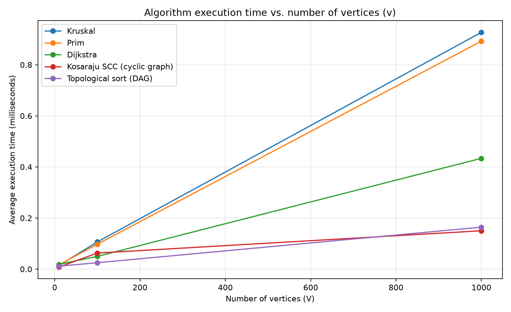
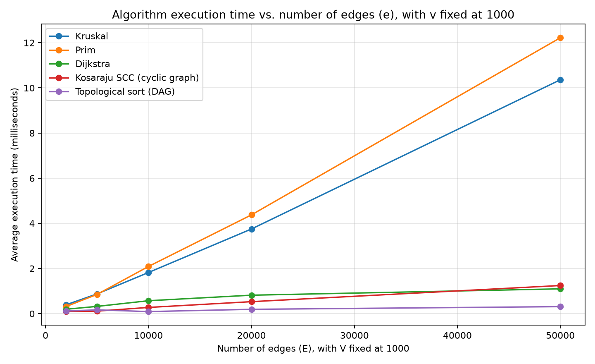

# Smart City Infrastructure and Route Planning

## Overview

This project models a city's districts as vertices and roads or infrastructure links as weighted edges. It implements algorithms for building a low-cost connected network, analyzing directed connectivity, and finding shortest routes. A separate benchmark runner generates reproducible graphs, measures the algorithms, and writes raw results to [`results/tables/benchmark_results.csv`](results/tables/benchmark_results.csv).

The implementation uses an adjacency-list graph representation. An undirected edge is stored once in the edge list and in both endpoint adjacency lists; a directed edge appears in the source vertex's adjacency list. Edge weights are integers. The graph class exposes read-only views of its edge collections.

## Implementation

| Area | Implementation |
|---|---|
| Graph model and generators | [`src/graph/Graph.java`](src/graph/Graph.java), [`src/graph/Edge.java`](src/graph/Edge.java), [`src/graph/GraphGenerator.java`](src/graph/GraphGenerator.java) |
| Disjoint Set Union | [`src/dsu/DisjointSetUnion.java`](src/dsu/DisjointSetUnion.java) |
| Minimum spanning trees | [`src/mst/Kruskal.java`](src/mst/Kruskal.java), [`src/mst/Prim.java`](src/mst/Prim.java), [`src/mst/MSTResult.java`](src/mst/MSTResult.java) |
| Directed connectivity | [`src/connectivity/TopologicalSort.java`](src/connectivity/TopologicalSort.java), [`src/connectivity/KosarajuSCC.java`](src/connectivity/KosarajuSCC.java) |
| Shortest paths | [`src/shortestpath/Dijkstra.java`](src/shortestpath/Dijkstra.java) |
| Demonstration, tests, and experiments | [`src/Main.java`](src/Main.java), [`src/tests/Tests.java`](src/tests/Tests.java), [`src/Experiments.java`](src/Experiments.java) |

The graph generator creates connected, simple undirected graphs by first adding a spanning tree and then adding unique edges. DAG edges are oriented from lower-numbered to higher-numbered vertices. The cyclic directed generator adds a directed cycle through every vertex before adding additional unique directed edges. All generated weights are in the range 1–100.

Kruskal's algorithm sorts edges and uses DSU to reject edges that would create a cycle. Prim's algorithm grows a minimum spanning forest with a priority queue. Both return the total selected weight, selected edges, and a connectivity flag; for a disconnected graph they return a minimum spanning forest.

DSU supports both path compression and union by rank. These optimizations can be enabled independently to compare all four combinations.

Topological ordering uses Kahn's algorithm. Its result includes an acyclic flag; when a cycle prevents a complete ordering, the returned order is partial. Strongly connected components use Kosaraju's two-pass depth-first search. Dijkstra uses a priority queue, returns distances and reconstructable paths, and rejects negative edge weights because its greedy finalization step is not correct for general graphs with negative weights.

## Complexity Analysis

Let `V` be the number of vertices and `E` the number of edges. Complexity assumes adjacency lists. Priority queues are binary heaps. Bounds describe the algorithms' asymptotic work; the benchmark's operation counters use narrower, implementation-specific definitions described below.

| Algorithm | Time complexity | Auxiliary space | Notes |
|---|---:|---:|---|
| DSU initialization | `O(V)` | `O(V)` | Creates one set for each vertex. |
| DSU find/union, with path compression and union by rank | Amortized `O(alpha(V))` per operation | `O(V)` | `alpha` is the inverse Ackermann function and grows so slowly that it is at most a small constant for practical input sizes. |
| DSU find/union, without both optimizations | Up to `O(V)` per operation in the worst case | `O(V)` | A sequence of unions can create a tall parent chain. Rank alone limits tree height to `O(log V)`; path compression flattens paths encountered by later finds. |
| Kruskal | `O(E log E + E alpha(V) + V)` with optimized DSU | `O(V + E)` | Sorting dominates; DSU processes candidate edges. |
| Prim (lazy edge priority queue) | `O(V + E log E)` | `O(V + E)` | The implementation pushes candidate edges and may retain `O(E)` queue entries. For simple graphs, `E <= V^2`, so this is commonly written `O((V + E) log V)`. |
| Kosaraju SCC | `O(V + E)` | `O(V + E)` | Two DFS traversals plus construction of the reversed adjacency lists. DFS is recursive in this implementation. |
| Topological ordering (Kahn) | `O(V + E)` | `O(V)` | Each vertex and edge is processed a constant number of times. |
| Dijkstra (lazy binary heap) | `O(V + E log E)` | `O(V + E)` | The heap can contain duplicate entries after successful relaxations. For simple graphs this is commonly expressed as `O((V + E) log V)`. |

For adjacency lists, storing vertices and edges takes `O(V + E)` space. Undirected edges have two adjacency entries, while the central edge list stores each undirected edge once. Increasing `V` adds per-vertex initialization and traversal work. Increasing `E` adds sorting, heap, or edge-scan work depending on the algorithm. For sparse graphs, `E` is close to `V`; for denser graphs, edge-dependent work becomes more prominent.

### Why Dijkstra does not support negative weights

Dijkstra assumes that once the smallest tentative-distance vertex is removed from the priority queue, no later route can improve its distance. With a negative edge, a path discovered later can reduce an already finalized distance, invalidating that assumption. This implementation explicitly scans the graph and throws an `IllegalArgumentException` if any edge has a negative weight. Use an algorithm such as Bellman–Ford when negative edges must be supported (and detect negative cycles separately).

## Experimental Setup

The experiments use a fixed base seed of `42`. For each vertex count, the runner derives separate deterministic seeds for the connected undirected graph, DAG, and cyclic directed graph. Re-running with the same code and seed reproduces the same generated graphs.

### Graph configurations

| Experiment | Vertices | Edges | Graph characteristics |
|---|---:|---:|---|
| Required small size | 10 | 30 | Connected undirected graph, DAG, and cyclic directed graph |
| Required medium size | 100 | 500 | Connected undirected graph, DAG, and cyclic directed graph |
| Required large size | 1,000 | 5,000 | Connected undirected graph, DAG, and cyclic directed graph |
| Edge-count sweep | 1,000 | 2,000; 5,000; 10,000; 20,000; 50,000 | Same three graph types, with vertex count held fixed |

The undirected graphs are connected by construction and are used for Kruskal, Prim, Dijkstra, and the DSU comparison. The directed acyclic graphs use only edges from a lower-numbered vertex to a higher-numbered vertex. The cyclic graphs contain a directed cycle through all vertices, so they are cyclic and strongly connected; additional edges preserve those properties. The edge-count sweep uses the same vertex count and seed for each graph type, so lower-edge configurations are prefixes of the corresponding higher-edge generator sequence.

Before timing, the runner checks that the undirected graph is connected, the DAG is acyclic, and the directed cyclic graph is detected as cyclic. It also checks that Kruskal and Prim report the same MST weight.

### Timing procedure and interpretation

For each measured task, the runner performs 20 warm-up invocations, then five timed batches of 20 invocations. It uses `System.nanoTime()` around each batch and reports total measured time divided by 100, in nanoseconds per invocation. Graph generation and the benchmark's preliminary graph checks are outside the timed batches. The task's algorithm operation counters and result extraction are inside the measured invocation; Dijkstra's task also counts reachable vertices. Consequently, timings include the cost of this instrumentation and small result-handling overhead, and should be interpreted as observed measurements rather than isolated, profiler-grade algorithm timings.

Each output row's `operations` value is taken from the final invocation. These counters are useful for comparing growth within an algorithm, but are **not directly comparable between algorithms**:

| Algorithm | What its operation counter includes |
|---|---|
| Kruskal | Comparator calls during sorting, one count per edge in its sorted-edge scan, and DSU's counter. |
| Prim | Candidate-edge queue insertions/removals, adjacency-edge examinations, and component-start insertions. It does not count comparisons performed internally by the priority queue. |
| Dijkstra | Initial source insertion, queue removals, adjacency-edge examinations, and successful-relaxation insertions. It does not count internal priority-queue comparisons. |
| Topological sort | Edge examinations during indegree construction and adjacency processing. It does not count all vertex initialization or queue operations. |
| Kosaraju SCC | Edge examinations in both DFS passes and edge insertions into the reversed graph. |
| DSU | `find`/`union` calls, parent-link traversals, and path-compression rewrites. Rank comparisons are not counted. |

Times depend on the processor, JVM, runtime state, and background system load. The CSV does not record machine or JVM metadata. Small timing differences—especially for the smallest graphs—should not be treated as meaningful without repeated runs on a controlled machine.

## Results

The raw measurements, including every algorithm, operation count, and status field, are in [`results/tables/benchmark_results.csv`](results/tables/benchmark_results.csv). The following summaries use the recorded run in that file. Times are shown in microseconds (`1 microsecond = 1,000 nanoseconds`); operation counts are shown in parentheses where included.

### Required graph sizes

| V | E | Kruskal time (ops) | Prim time (ops) | MST weight (both) | Dijkstra time (ops) | Reachable from 0 |
|---:|---:|---:|---:|---:|---:|---:|
| 10 | 30 | 14.237 (275) | 16.818 (122) | 221 | 18.528 (94) | 10 |
| 100 | 500 | 106.452 (6,817) | 97.595 (2,002) | 1,320 | 49.716 (1,386) | 100 |
| 1,000 | 5,000 | 927.056 (80,719) | 892.400 (20,002) | 12,593 | 433.717 (13,914) | 1,000 |

Kruskal and Prim agree on the MST weight at every required size. Their relative timing changes with graph size: Kruskal is faster in the small case, while Prim is slightly faster in the medium and large cases in this run. This is consistent with both algorithms having different practical overheads; it does not establish a universal winner.

| V | E | Topological DAG time (ops) | Topological cyclic time (ops) | SCC DAG time (ops) | SCC cyclic time (ops) |
|---:|---:|---:|---:|---:|---:|
| 10 | 30 | 11.421 (60) | 3.450 (30) | 15.873 (90) | 7.914 (90) |
| 100 | 500 | 25.023 (1,000) | 4.555 (500) | 40.536 (1,500) | 62.801 (1,500) |
| 1,000 | 5,000 | 164.252 (10,000) | 42.399 (5,000) | 249.971 (15,000) | 150.058 (15,000) |

The DAG contains no cycles, so its SCC count is `V` (each vertex is its own component). The directed cyclic graph has one SCC because its spanning directed cycle reaches every vertex. For these generated graphs, the topological-sort operation count is `2E` on the DAG and `E` on the cyclic graph: the cyclic graph has no zero-indegree vertices, so Kahn's algorithm detects the cycle after the indegree scan without processing adjacency lists. The latter count therefore reflects this particular cyclic input, not the full worst-case work of topological sorting.

### Edge-count sweep (`V = 1,000`)

Times are in microseconds.

| E | Kruskal | Prim | Dijkstra | Topological DAG | Topological cyclic | SCC DAG | SCC cyclic |
|---:|---:|---:|---:|---:|---:|---:|---:|
| 2,000 | 395.000 | 318.655 | 197.620 | 119.393 | 21.679 | 114.608 | 95.789 |
| 5,000 | 875.891 | 853.162 | 323.423 | 169.168 | 61.683 | 148.184 | 114.431 |
| 10,000 | 1,824.724 | 2,092.155 | 574.432 | 93.523 | 13.967 | 349.184 | 277.491 |
| 20,000 | 3,751.323 | 4,376.666 | 819.706 | 194.477 | 52.278 | 609.785 | 532.885 |
| 50,000 | 10,359.526 | 12,220.659 | 1,100.826 | 313.137 | 56.762 | 1,379.767 | 1,248.097 |

The MST and Dijkstra timings generally rise as the number of edges increases. SCC timings also trend upward overall, consistent with its `O(V + E)` work. Topological-sort times fluctuate more in this run, particularly for the cyclic inputs; the operation-count behavior above and JVM/system timing variation are important context when interpreting these values.

### DSU optimization comparison

The DSU comparison uses the required size graphs and reports both measured time (microseconds) and the DSU operation counter.

| V | Path compression | Union by rank | Time (microseconds) | Operations |
|---:|:---:|:---:|---:|---:|
| 10 | yes | yes | 4.731 | 152 |
| 10 | yes | no | 0.692 | 191 |
| 10 | no | yes | 1.980 | 152 |
| 10 | no | no | 1.115 | 350 |
| 100 | yes | yes | 7.662 | 2,587 |
| 100 | yes | no | 15.052 | 3,371 |
| 100 | no | yes | 9.157 | 2,587 |
| 100 | no | no | 98.355 | 48,241 |
| 1,000 | yes | yes | 29.902 | 25,991 |
| 1,000 | yes | no | 48.484 | 39,011 |
| 1,000 | no | yes | 28.460 | 25,991 |
| 1,000 | no | no | 9,292.331 | 4,779,911 |

The operation counts show the expected benefit most clearly: with neither optimization, the 1,000-vertex workload performs far more parent traversals than the optimized variants. Timing at small sizes is noisy and does not always follow the operation-count ranking. At the largest size, disabling both optimizations causes a substantial increase in both measured work and elapsed time.

### Plots

The plots below visualize the recorded average execution times. The edge plot holds `V = 1,000` constant. Each line is a different algorithm/graph-type series; consult the labels and the CSV for the corresponding graph type and raw values.

**Execution time vs. number of vertices**



**Execution time vs. number of edges (V = 1,000)**



## Comparison and Discussion

- **Kruskal vs. Prim:** Both produce the same MST weights on the connected test graphs. Kruskal sorts all edges, while Prim explores candidate edges from the current tree. Their measured timings cross over across the required sizes, so the observed data supports discussing the trade-off rather than claiming one is always faster. On the edge sweep, Kruskal is faster at 10,000–50,000 edges in this run, while Prim is faster at 2,000 and 5,000 edges.
- **DSU:** Rank and path compression reduce the number of parent links traversed across a sequence of operations. The comparison is clearest at `V = 1,000`; the unoptimized variant records about 4.78 million operations versus about 26 thousand for both optimizations enabled. Timing is noisier than operation counts and the counter's definition should be kept in mind.
- **SCC:** Kosaraju's operation counts are three edge passes for these generated cases (first DFS, reverse-graph construction, second DFS), giving `3E`. Both time and counts rise overall as `E` increases. The component count differs by input construction: `V` singleton components in the DAG and one component in the directed-cycle graph.
- **Topological ordering:** The DAG returns a full ordering, while cyclic inputs are detected and return no full ordering. The counter is input-path dependent: the directed cycle has no initially ready vertices, so processing stops after the indegree pass. Runtime measurements for these cases are variable and should not be generalized from a single run.
- **Dijkstra:** All vertices are reachable from source 0 in the connected undirected benchmark graphs. The shortest-path algorithm uses non-negative generated weights, as required. Its execution time and operation count increase with edge count in the recorded edge sweep.

The theoretical bounds describe how work scales as input grows; the measured times also reflect constant factors, allocation, operation counting, JVM behavior, and the particular generated graphs. The timing data is a single recorded run, not a statistical comparison with confidence intervals.

## Testing

The test program is [`src/tests/Tests.java`](src/tests/Tests.java). The current test run reports **27 passed, 0 failed**. It covers:

- Small weighted graphs, disconnected graphs, duplicate edge weights, multiple valid MSTs, and a single-vertex graph.
- Agreement between Kruskal and Prim, including connectedness and selected-edge counts.
- DSU find/union behavior for all four path-compression/rank combinations.
- Valid topological ordering for DAGs, cycle detection, and a single-vertex DAG.
- Expected SCC membership and the requirement that each vertex belongs to exactly one component.
- Dijkstra distances, reconstructed paths, unreachable vertices, zero-weight edges, and rejection of negative weights.
- Randomized checks across 20 seeds, including MST agreement, DAG validity, SCC membership, and Dijkstra distances compared with a Bellman–Ford test reference.
- Required graph sizes, generated edge counts, connectedness, and DAG validity.

## Running the Project

The Java application has no external Java dependencies. From the repository root, compile all source files and run the demo, tests, and experiments.

**Windows PowerShell**

```powershell
New-Item -ItemType Directory -Force out | Out-Null
$sources = Get-ChildItem src -Recurse -Filter *.java | ForEach-Object FullName
javac -d out $sources
java -cp out Main
java -cp out tests.Tests
java -cp out Experiments
```

**Linux/macOS shell**

```sh
mkdir -p out
javac -d out $(find src -name '*.java')
java -cp out Main
java -cp out tests.Tests
java -cp out Experiments
```

Running `Experiments` overwrites the benchmark CSV with a new run. To regenerate the figures from that CSV, install Python 3 and Matplotlib (`python -m pip install matplotlib`) and run:

```sh
python results/plots/plots.py
```

On Windows PowerShell, use `python results\plots\plots.py`.

## Conclusion

The project implements and tests the required graph algorithms and records reproducible benchmark data for the required graph sizes and an additional edge-count sweep. Kruskal and Prim are both suitable for connected weighted infrastructure networks; the observed timings depend on graph size and run conditions. DSU optimizations substantially reduce work on larger union-find workloads. Kosaraju and Kahn's algorithm provide linear-time tools for directed connectivity and dependency ordering, while Dijkstra is appropriate for routing with non-negative travel costs. For graphs with negative edge weights, a different shortest-path algorithm is required.
